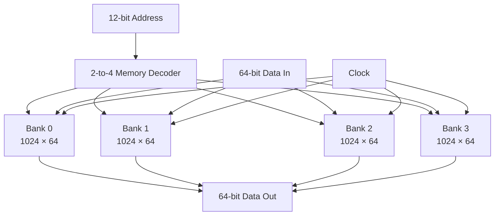
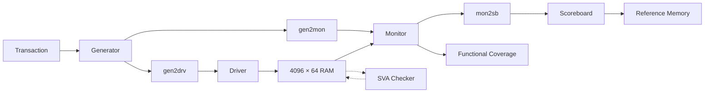
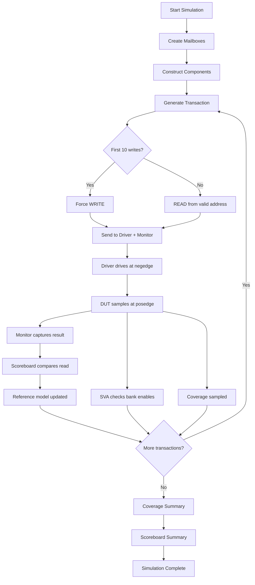
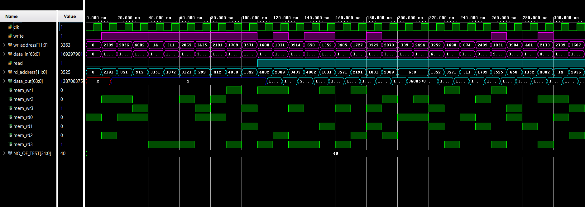

# 🧠 32KB RAM — SystemVerilog Functional Verification

<p align="center">


**A complete SystemVerilog verification environment for a synchronous 4096 × 64-bit RAM.**

</p>

---

## 📌 Project Overview

This project implements and verifies a **4096 × 64-bit synchronous RAM** with:

- 4096 addressable locations
- 64-bit data width
- 12-bit address
- 32 KB total storage
- Four 1024 × 64 memory banks
- Synchronous read/write operation
- Address-based bank decoding
- Random transaction generation
- Mailbox-based communication
- Reference-model-based scoreboard
- Functional coverage
- SystemVerilog Assertions (SVA)
- `bind`-based assertion attachment
- Questa/ModelSim waveform debugging

The goal is to demonstrate a structured **SystemVerilog class-based verification methodology** without UVM.

---

# 🏗️ 1. RTL DESIGN ARCHITECTURE

The 4096 × 64 RAM is divided into four banks:

```text
4 × (1024 locations × 64 bits)
= 262,144 bits
= 32,768 bytes
= 32 KB
```

### Address organization

```text
                 12-bit Address
        ┌──────────────┬───────────────┐
        │   11 : 10    │     9 : 0     │
        └──────┬───────┴───────┬───────┘
               │               │
          Bank Select       Local Address
            2 bits             10 bits
```

| Address Range | Bank |
|---|---:|
| `0x000 – 0x3FF` | Bank 0 |
| `0x400 – 0x7FF` | Bank 1 |
| `0x800 – 0xBFF` | Bank 2 |
| `0xC00 – 0xFFF` | Bank 3 |

## 🎨 RTL Block Diagram



> **Important:** Only the selected bank should actively drive the common `data_out`. Unselected banks release the output using `Z` to prevent bus contention.

---

# 🧩 2. RTL MODULES

### `Ram_4096.v`

Top-level RAM module. It:

- accepts the 12-bit address,
- separates bank-select and local-address fields,
- generates bank enables,
- instantiates four memory banks,
- connects the selected bank to the common output.

### `mem_decoder.v`

Implements the 2-to-4 bank decoder.

```text
addr[11:10]
     │
     ▼
┌───────────┐
│  2-to-4   │
│  Decoder  │
└─────┬─────┘
      │
 ┌────┼────┬────┐
 ▼    ▼    ▼    ▼
 B0   B1   B2   B3
```

At most one bank should be selected for a given access.

### `dual_port_mem.v`

Implements the actual 1024 × 64 storage.

Write:

```systemverilog
if (mem_en && write)
    memory[wr_address] <= data_in;
```

Read:

```systemverilog
if (op_en && read)
    data_out <= memory[rd_address];
else if (!op_en)
    data_out <= {RAM_WIDTH{1'bz}};
```

Because the operations are synchronous, reads and writes occur on `posedge clk`.

---

# 🧪 3. SYSTEMVERILOG TESTBENCH ARCHITECTURE



The environment follows:

```text
Transaction → Generator → Driver → DUT → Monitor → Scoreboard
```

with SVA and coverage operating alongside the main flow.

---

# 📦 4. TRANSACTION

The transaction class represents one RAM operation:

```text
data_in
wr_address
rd_address
read
write
data_out
```

`rand` fields are randomized by the generator.

The transaction is the packet of information passed between verification components.

---

# 🎲 5. GENERATOR

The generator creates randomized transactions.

The first **10 transactions are forced to be writes** so that valid initialized addresses are available.

Those addresses are stored in:

```systemverilog
bit [11:0] written_addresses[$];
```

Future reads select an address from this queue.

```text
Random Transaction
        │
        ▼
   First 10?
    /       YES      NO
   │        │
 WRITE     READ from
   │       valid address
   ▼        │
Store ──────┘
address
```

This avoids meaningless reads from unwritten locations that may contain `X`.

Later transactions may also contain a write, allowing simultaneous read/write activity.

---

# 🚗 6. DRIVER

The driver converts the transaction into DUT signals.

Inputs are driven at:

```systemverilog
@(negedge vif.clk);
```

The DUT samples them at:

```systemverilog
@(posedge clk);
```

```text
Driver                         DUT
  │                             │
  │ drive                       │
  ▼                             │
negedge ────────────────────────┤
                                │
        signals settle          │
                                │
posedge ────────────────────────┤
                                ▼
                         DUT samples inputs
```

This gives a clean half-cycle for stimulus setup.

---

# 👀 7. MONITOR

The monitor is passive.

It:

1. observes the DUT,
2. captures read data,
3. forwards transactions to the scoreboard,
4. samples functional coverage.

Because the RAM read is synchronous, the monitor waits for the DUT's nonblocking update before sampling `data_out`.

```text
posedge
   │
   ├── DUT schedules data_out
   ├── NBA update
   └── #1
        ↓
   Monitor samples output
```

---

# 🧠 8. SCOREBOARD + REFERENCE MODEL

The scoreboard maintains an associative-array reference model:

```systemverilog
ref_mem[address] = expected_data;
```

### Write

```text
Write Address + Data
        ↓
Reference Memory
        ↓
ref_mem[address] = data
```

### Read

```text
Read Address
     ↓
Reference Memory
     ↓
Expected Data
     │
     ├──────────────┐
     ↓              ↓
 Expected         Actual
     └──── Compare ┘
             ↓
        PASS / FAIL
```

The comparison uses:

```systemverilog
actual === tr.data_out
```

For simultaneous read/write to the same address, the scoreboard checks the read against the old value first and then updates the reference model, matching the DUT's nonblocking-assignment behavior.

---

# 🛡️ 9. SYSTEMVERILOG ASSERTIONS

`TB/ram_assertions.sv` contains structural checks for bank selection.

The checker verifies:

- at most one read bank is selected,
- at most one write bank is selected.

The core check is:

```systemverilog
$onehot0({mem_rd3, mem_rd2, mem_rd1, mem_rd0})
```

`$onehot0()` accepts:

```text
0000 → PASS
0001 → PASS
0010 → PASS
0100 → PASS
1000 → PASS
```

but rejects:

```text
0011 → FAIL
1010 → FAIL
1111 → FAIL
```

The same principle is used for write enables.

---

# 🔗 10. `bind` — CONNECTING THE ASSERTION CHECKER

The checker is attached without modifying the RTL:

```systemverilog
bind Ram_4096 ram_assertions sva_i (
    .clk     (clk),
    .mem_rd0 (mem_rd0),
    .mem_rd1 (mem_rd1),
    .mem_rd2 (mem_rd2),
    .mem_rd3 (mem_rd3),
    .mem_wr0 (mem_wr0),
    .mem_wr1 (mem_wr1),
    .mem_wr2 (mem_wr2),
    .mem_wr3 (mem_wr3)
);
```

Conceptually:

```text
              Ram_4096
                 │
        ┌────────┴────────┐
        │                 │
     RTL Logic       sva_i checker
                          │
                     SVA properties
```

`bind` keeps design RTL and verification code cleanly separated.

---

# 📊 11. FUNCTIONAL COVERAGE

Coverage answers:

> **Did the test actually exercise the intended scenarios?**

The covergroup is automatically sampled at:

```systemverilog
@(posedge vif.clk)
```

### Address-bank coverage

```text
Bank 0 :    0 – 1023
Bank 1 : 1024 – 2047
Bank 2 : 2048 – 3071
Bank 3 : 3072 – 4095
```

### Read coverage

```text
read = 0
read = 1
```

### Write coverage

```text
write = 0
write = 1
```

### Read × Write cross

| Read | Write | Meaning |
|---:|---:|---|
| 0 | 0 | Idle |
| 0 | 1 | Write only |
| 1 | 0 | Read only |
| 1 | 1 | Simultaneous read/write |

The current stimulus intentionally focuses on useful RAM operations, so the idle combination may remain uncovered.

---

# ⏱️ 12. TESTBENCH TIMING

Clock period = **10 ns**.

```text
Time:   0    5    10   15   20   25   30 ns
        │    │     │    │    │    │    │
CLK:    └────┐     └────┐     └────┐
             │          │          │
          posedge    posedge    posedge
```

```text
Driver  → negedge
DUT     → posedge
Monitor → posedge + NBA settling
```

This separates stimulus application from DUT sampling.

---

# 🔄 13. COMPLETE VERIFICATION FLOW



---

# 🧪 14. VERIFICATION STRATEGY

| Layer | Purpose |
|---|---|
| Random transactions | Generate varied stimulus |
| Valid-address queue | Avoid unwritten reads |
| Driver | Apply stimulus |
| Monitor | Observe DUT |
| Reference model | Predict expected data |
| Scoreboard | Detect functional mismatches |
| Functional coverage | Measure exercised scenarios |
| SVA | Detect illegal bank selection |
| Waveform | Debug timing and behavior |

The project therefore combines:

**Functional correctness + Structural checking + Coverage + Waveform debugging**

---

# 📈 15. SIMULATION RESULTS

The simulation waveform is stored at:

```text
Results/
└── waveform/
    └── waveform.png
```

### Waveform

<p align="center">



</p>

The waveform is useful for verifying:

- clock timing,
- read/write controls,
- addresses,
- input data,
- bank selection,
- synchronous read behavior,
- output data,
- simultaneous read/write behavior.

> **Note:** The final numerical coverage/pass statistics should be updated from the actual regression output.

---

# 📋 16. EXPECTED SIMULATION OUTPUT

Example scoreboard summary:

```text
============================================================
[SCOREBOARD] VERIFICATION SUMMARY
============================================================
Total Transactions : 40
Read Passes        : XX
Read Failures      : 0
RESULT             : TEST PASSED
============================================================
```

Example coverage summary:

```text
=============================================================================
                        FUNCTIONAL COVERAGE REPORT
=============================================================================
[COVERAGE] Overall Functional Coverage : XX.XX%
-----------------------------------------------------------------------------
[COVERAGE] Address Bank Coverage       : XX.XX%
[COVERAGE] Write Address Bank Coverage : XX.XX%
[COVERAGE] Read Enable Coverage        : XX.XX%
[COVERAGE] Write Enable Coverage       : XX.XX%
[COVERAGE] Read/Write Cross Coverage   : XX.XX%
=============================================================================
```

Successful SVA checks normally produce no failure message. Assertion failures appear in the simulator transcript.

---

# 📁 17. PROJECT STRUCTURE

```text
32KB RAM Verification/
│
├── RTL/
│   ├── Ram_4096.v
│   ├── dual_port_mem.v
│   └── mem_decoder.v
│
├── TB/
│   ├── Test_Ram_4096.sv
│   └── ram_assertions.sv
│
├── Simulation/
│   └── waveform.wdb
│
├── Results/
│   └── waveform/
│       └── waveform.png
│
├── README.md
└── .gitignore
```

---

# 🛠️ 18. TOOLS & TECHNOLOGIES

- **Verilog** — RTL design
- **SystemVerilog** — Testbench, classes, mailboxes, coverage and assertions
- **Questa / ModelSim** — Simulation and waveform analysis
- **SVA** — Assertion-based verification
- **Git / GitHub** — Version control

---

# 🎯 19. SYSTEMVERILOG CONCEPTS DEMONSTRATED

### Testbench
- Interfaces
- Virtual interfaces
- Classes
- Objects
- Constructors
- Tasks
- Mailboxes
- `fork...join`

### Stimulus
- `rand`
- `randomize()`
- Dynamic queues
- Random valid-address selection

### Checking
- Reference model
- Associative arrays
- Scoreboard
- Case equality (`===`)

### Coverage
- Covergroups
- Coverpoints
- Bins
- Cross coverage
- Automatic sampling
- `get_coverage()`

### Assertions
- Concurrent assertions
- `$onehot0()`
- `assert property`
- `bind`

---

# 🧠 20. IMPORTANT DESIGN & VERIFICATION INSIGHTS

## Why are unwritten reads avoided?

The RAM has no reset for all storage locations. Therefore an unwritten location can contain `X` in simulation.

The generator creates valid written addresses first and selects future reads from those addresses.

## Why use both a queue and associative array?

They answer different questions.

```text
written_addresses[$]
    → Which addresses are valid to read?

ref_mem[address]
    → What data should be expected?
```

## Why does the scoreboard check before updating?

For a same-cycle read/write to the same address:

```text
1. READ → check old value
2. WRITE → update reference model
```

This matches the DUT's nonblocking assignment behavior.

---

# 🚀 21. FUTURE IMPROVEMENTS

- Increase regression length from 40 to thousands of transactions.
- Add same-bank/different-bank coverage.
- Add same-address read/write coverage.
- Add more timing assertions.
- Add reset support if reset is introduced.
- Add negative testing and error injection.
- Add coverage closure analysis.
- Separate the reference model into its own class.
- Add reusable sequences.
- Convert the environment to **UVM** after mastering the current SystemVerilog environment.

---

# 🏁 22. CONCLUSION

This project demonstrates a complete **non-UVM SystemVerilog verification flow** for a synchronous 32KB RAM:

```text
Random Stimulus
      +
Transaction-Based Testbench
      +
Reference Model
      +
Scoreboard
      +
Functional Coverage
      +
SystemVerilog Assertions
      +
Waveform Debugging
```

It provides a strong foundation for moving from basic SystemVerilog verification into larger **UVM-based verification projects**.

---

## 👨‍💻 Author

**Chhandak Roy**

M.Tech — VLSI & Nanoelectronics  
Indian Institute of Technology Guwahati

---

<p align="center">

⭐ **Designed, verified and debugged using Verilog + SystemVerilog**

</p>
